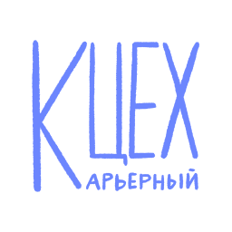

<div align="center">
  <br>
  
  <h1>vas3k.club</h1>
</div>

Welcome to the [vas3k.club](https://vas3k.club) codebase. We're building our own little IT-lifestyle community. We've opensourced the code so that every member could contribute or implement a feature that they want.

[vas3k.club](https://vas3k.club) is a platform with private and paid memberships that has emerged around the [vas3k.blog](https://vas3k.blog) blog and satellite chat rooms. It's not a typical IT community with tutorials and framework reviews, but rather more of a lifestyle one. We are trying to build a peaceful and useful ecosystem, which the Internet has lost a long ago. Therefore, we carefully select and filter new members and do not seek wild growth.

Our values: honesty, fair share, respect for other members, rationality, friendliness and usefulness. We have a zero-tolerance policy on anonymity, insults and toxicity. But we always try to stay in touch with reality, so we're also not tolerant of witch hunting and call-out culture.

## 🛠 Tech stack: use AGENTS.md

Django renders pages and handles routing, authentication, forms, and JSON endpoints. React islands add interactive pieces inside those pages using plain JavaScript and JSX. Vite builds the frontend, and django-vite inserts either development-server URLs or hashed production assets into the templates. There is no SPA or client-side router.

| Part | Responsibility |
| --- | --- |
| Django + PostgreSQL | Pages, APIs, membership, posts, comments, and other persistent data |
| React islands + Vite | Interactive widgets; EasyMDE editors and Mapbox maps |
| Redis + Django Q2 | Cache and queued background work, including notifications |
| Club bot and helpdeskbot | Separate Telegram services sharing the Django code and database |
| Supercronic | Scheduled Django management commands from `etc/crontab` |

See [AGENTS.md](AGENTS.md) for a deeper dive.

## 🔮 Running locally

Use Docker for a complete development environment, or native commands if you already run PostgreSQL and Redis locally. Run commands from the repository root.

### Docker: full local setup

Install Docker with Compose, then:

```sh
git clone https://github.com/vas3k/vas3k.club.git
cd vas3k.club
docker compose up --build
```

Compose starts Django, PostgreSQL, Redis, queue workers, and Vite. It installs dependencies, applies migrations, and initializes tags. Wait for startup, then open [localhost:8000](http://127.0.0.1:8000/).

### Native: Django Runverver + npm run dev

Install **Python + uv**, **Node.js**, **PostgreSQL** and **Redis** locally. Start the database services and create a local `vas3k_club` database. See [club/.env.example](club/.env.example) and [club/settings.py](club/settings.py).

Install and initialize once:

```sh
uv sync --frozen
npm ci --prefix frontend
npm run build --prefix frontend
uv run python manage.py migrate
uv run python manage.py update_tags
```

Start Django and Vite in separate terminals:

```sh
# Terminal 1
VITE_DEV_MODE=true uv run python manage.py runserver

# Terminal 2
npm run dev --prefix frontend
```

Open [localhost:8000](http://127.0.0.1:8000/). Run `uv run python manage.py qcluster` in another terminal when you need background jobs.

Djando and Vite restart on changes automatically.

### Sign in and configure optional services

- [Admin login](http://127.0.0.1:8000/godmode/dev_login/) creates or reuses the `dev` account; a newly created account has the `god` role.
- [Random member login](http://127.0.0.1:8000/godmode/random_login/) creates a new member each time.
- [Godmode](http://127.0.0.1:8000/godmode/) is the administration UI.

These login shortcuts require debug mode. Use local sample data. Telegram, SMTP, payment, and AI credentials are optional for local work; some features, including creating posts, require a linked development bot.

## ☄️ Tests and checks

With native dependencies and local database services ready:

```sh
TESTS_RUN=true uv run python manage.py test
npm test --prefix frontend
npm run build --prefix frontend
```

For backend tests in the running Docker stack:

```sh
docker compose exec -e TESTS_RUN=true club_app python3 manage.py test
```

[CI](.github/workflows/tests.yml) runs backend tests, existing frontend tests, and Flake8.

## 🤖 Telegram bots

Copy `club/.env.example` to a root `.env` and uncomment only settings you need. Keep one local configuration file: an old `club/.env` can take precedence. Never commit credentials. Compose sets its own database/Redis service hosts; do not replace those with `localhost` inside containers.

Use separate development bots and chats. The Club bot needs `TELEGRAM_TOKEN`, `TELEGRAM_BOT_URL`, and the relevant chat IDs. Helpdesk needs `TELEGRAM_HELP_DESK_BOT_TOKEN`, `TELEGRAM_HELP_DESK_BOT_QUESTION_CHANNEL_ID`, and `TELEGRAM_HELP_DESK_BOT_QUESTION_CHANNEL_DISCUSSION_ID`; link its channel to the discussion group. In debug mode bots poll; production uses webhooks. Run the shared queue for notifications.

```sh
uv run python bot/main.py
# Separate terminal, if needed:
uv run python helpdeskbot/main.py
```

With Docker, run the equivalent command through `docker compose exec club_app python3 …`.

## 🚢 Deployment

Production uses Docker Compose on one host, with Nginx and PostgreSQL managed outside Compose. There is no production Vite server or separate frontend runtime. See [docker-compose.production.yml](./docker-compose.production.yml) for details.

```text
Browser → Nginx → Gunicorn/Django :8814 → host PostgreSQL
              ├→ static files             Redis ← queue workers
              └→ bot webhooks :8816/:8817

One release image: web + queue + Club bot + helpdeskbot + cron
```

The [Dockerfile](Dockerfile) installs locked Python dependencies with uv and builds frontend assets with Node/Vite. The runtime image contains both Django and `frontend/static/dist/`, including the Vite manifest. [Production Compose](docker-compose.production.yml) runs each process as a separate service using that same image. The web entrypoint applies migrations, updates achievements, copies static files to the host-mounted directory, and starts Gunicorn. [Nginx](etc/nginx/vas3k.club.conf) serves `/static/` from that directory and proxies website and bot requests. Uploads use a separate image service.

## 🛤 Forking and tweaking

Forks are welcome. We're small and our engine is not universal like Wordpress, but with sufficient programming skills (and using grep), you can launch your own Club website in a couple of weeks.

Three huge requests for everyone:

- Please give kudos to the original authors. "Works on vas3k.club engine" in the footer of your site will be enough.
- Please share new features you implement with us, so other folks can also benefit from them, and your own codebase minimally diverges from the original one (so you can sync updates and security fixes). Use our [feature-flags](club/features.py).
- Do not use our "issues" and chats as a support desk for your own fork.

> ♥️ [Feature-flags](club/features.py) are great. Use them to tweak your fork. Create new flags to upstream your new features or disable existing ones.

For a fork, configure your domain, mail delivery, image upload service, payment providers, bot accounts, and backups before accepting members. Customize the landing page and `templates/docs/`; use Godmode to manage rooms and member roles.

## 🙋‍♂️ How to report a bug or propose a feature?

- Open [a new issue](https://github.com/vas3k/vas3k.club/issues/new) using one of the existing templates.
- Please **use the search function** to make sure you aren't creating a duplicate.
- Provide ALL the details, screenshots, logs, etc. Bug reports without steps to reproduce will be closed.

## 😍 Contributions

Important information for everyone willing to contribute to this project.

- AI-generated PRs are NOT welcome.
- Low-effort PRs are NOT welcome.
- No cowboy PRs without prior discussion AND approval from maintainers.
- 1 PR = 1 feature. No PRs with bulk changes.
- Any PR longer than 10 lines of code must include a detailed text explanation of all changes.

**A good way to contribute bug fixes:** search the Issues to make sure the bug hasn't been reported yet. Open a new Issue with a detailed description and steps to reproduce. Open a PR with the fix (if you can), then the contributors will either merge your PR or you'll carry on the discussion in the comments.

**For new features:** open a new Issue describing the new feature you're interested in. Wait for the contributors to get back to you and give you the green light for implementation. If the contributors don't reply, it means the feature isn't of interest at the moment. ONLY after that should you open a PR for that feature.

The main point of interaction is the [Issues page](https://github.com/vas3k/vas3k.club/issues) and our [Dev-chat in Telegram](https://t.me/vas3k_club_dev). DO NOT DISCUSS FORKS THERE.

If you want to contribute but don't know where to start — come to the chat and just ask!

> The official development language at the moment is Russian, because 100% of our users speak it. We don't want to introduce unnecessary barriers for them. But we are used to writing commits and comments in English and we won't mind communicating with you in it.

## 🔐 Security and vulnerabilities

If you think you've found a critical vulnerability that should not be exposed to the public yet, you can always email me directly on Telegram [@vas3k](https://t.me/vas3k) or by email: [me@vas3k.ru](mailto:me@vas3k.ru).

Please do not test vulnerabilities in public. If you start spamming the website with "test-test-test" posts or comments, our moderators will ban you even if you had good intentions.

## 👩‍💼 License

[MIT](LICENSE)

You can use the code for your own private or commercial purposes with an author attribution (by including the original license file and mentioning vas3k.club somewhere on your website 🎩).

Feel free to contact us via email [club@vas3k.club](mailto:club@vas3k.club).

❤️
